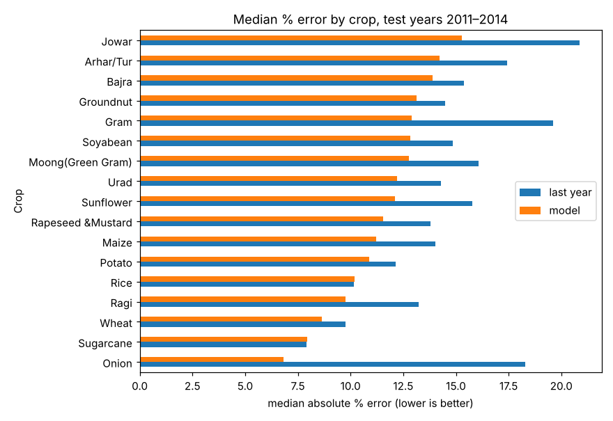
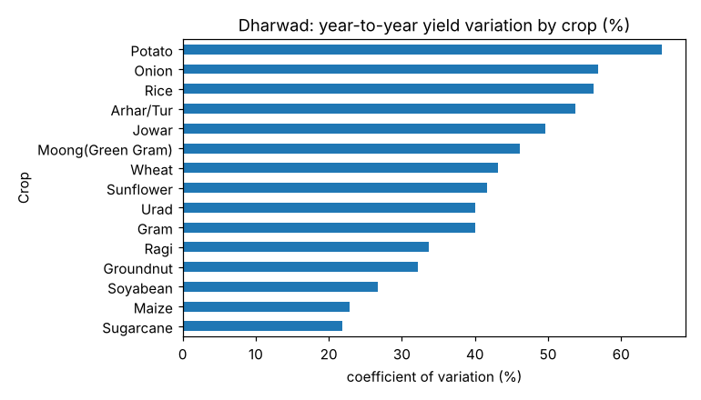

# Early Crop Yield Estimation for Indian Districts

Crop insurance payouts, drought relief and procurement planning in India depend on **official crop yield estimates**, which arrive months after the harvest. This project asks: **can a district's yield be estimated early, using its own history plus the yields already reported by other districts in the same state that season?**

Data: crop-wise Area, Production and Yield for every Indian district, 1997–2014 (Ministry of Agriculture, published on data.gov.in), about 246,000 records → 125,000 clean rows across 645 districts and 17 major crops. Special focus on **Dharwad, Karnataka**.

## Key results (test years 2011–2014, never seen in training)

| Method | Median % error | R² |
|---|---|---|
| Reuse last year's yield | 13.8% | 0.92 |
| District's historical average | 18.6% | 0.92 |
| History × peer-district ratio (simple rule) | 11.8% | 0.96 |
| **Gradient-boosted model** | **11.2%** | **0.96** |

- **Dharwad:** median error drops from **22.8% → 11.9%**.
- **Crop-failure alerts** (yield < 70% of normal): precision 0.20 → **0.50**, recall 0.31 → **0.38** vs. last year's yield.
- Honest finding: the **peer-district signal** does most of the work. A simple rule using it is almost as good as the ML model, which adds only a small further gain.





## Method
1. Cleaning: 17 crops measured in tonnes, remove missing/zero/tiny-area records and the top 0.5% of yields per crop.
2. Features using only information available **before** the district's own figure: previous yields, historical average, and same-season yields of other districts in the state (the district itself is always excluded).
3. **Time-based split**: train 1999–2010, test 2011–2014.
4. Gradient-boosted trees (`HistGradientBoostingRegressor`) predicting yield relative to the district's historical average, compared with three non-ML baselines.
5. Permutation importance, error by crop, and a crop-failure early-warning threshold tuned on validation years 2009–2010.

## Run it
```
pip install -r requirements.txt
jupyter notebook india_crop_yield_estimation.ipynb
```

## Limitations and next steps
No weather, soil or satellite data yet; needs at least three other districts to have reported; district averages hide farm-level differences. Next: add IMD rainfall and temperature, satellite vegetation indices (NDVI), and test at taluk level.

## Data source
Crop Production Statistics, Ministry of Agriculture & Farmers Welfare, Government of India, via the Open Government Data Platform (data.gov.in), used under the Government Open Data License – India. Copy obtained from a public GitHub mirror (`data/crop_production.csv`).

---
Built as a learning project with AI-assisted tools; I worked through each step so I can explain the data, methods and results.
